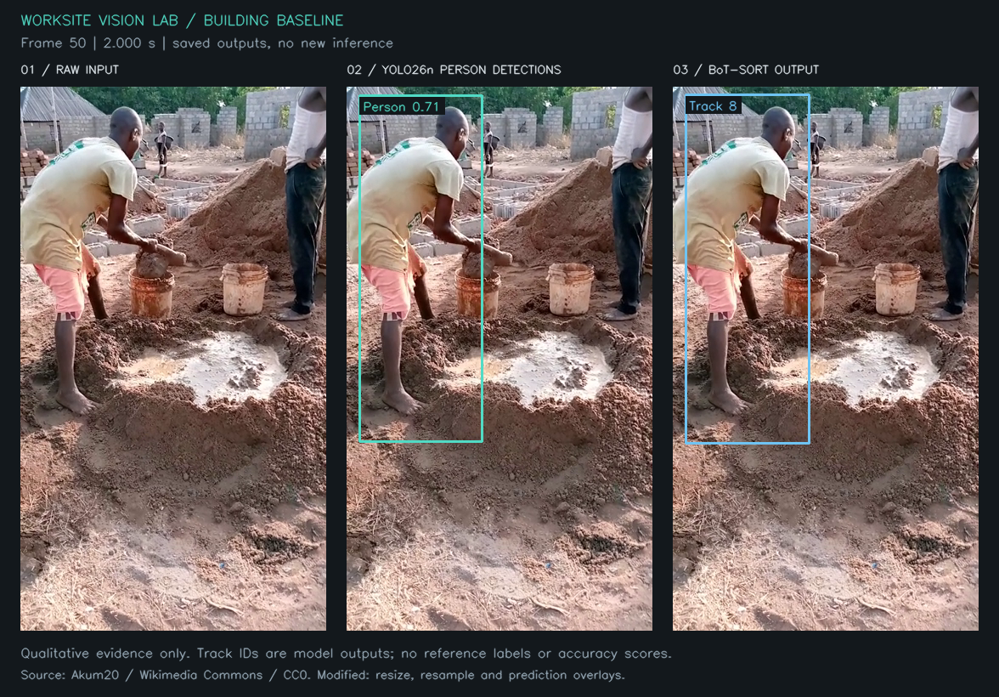
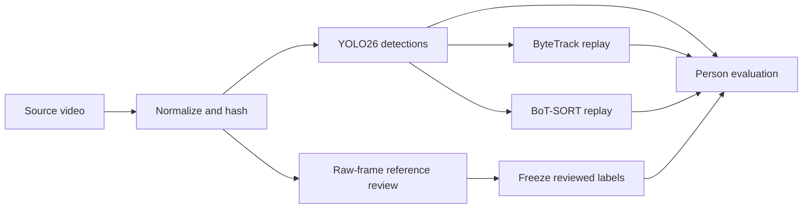

# Worksite Vision Lab

Reproducible construction-video detection and person-tracking research. The project
investigates missed people, duplicate detections and identity continuity before
turning PPE predictions into worker-specific safety events.

**Research prototype:** YOLO26 inference and ByteTrack/BoT-SORT replay have run on
two licensed clips covering 298 frames. Person annotation and offline evaluation
tools are implemented. Real-video accuracy is still unmeasured; PPE association,
safety events and the web application are planned work.

[Baseline findings](experiments/reports/BASELINE_CPU.md) ·
[Tracker comparison](experiments/reports/TRACKING_COMPARISON.md) ·
[Evaluation protocol](docs/PERSON_EVALUATION.md) ·
[Engineering readiness](docs/ENGINEERING_READINESS.md)

## A real failure, with its input preserved



Building clip, frame 50 at 2.000 seconds. Only Person predictions are displayed.
The cropped person on the right has no detector box or emitted track in this frame;
tracker selection alone cannot recover a missing detection. This is a qualitative
investigation, not a scored false negative or identity benchmark. Track IDs are
video-local model outputs. Source: Akum20, CC0; resized, resampled and overlaid.
[Figure inputs and reproduction](docs/figures/building-baseline/README.md).

## What is implemented

| Component | Working behavior | Evidence |
|---|---|---|
| Input provenance | Source hashes, normalization manifests and decoded frame counts | [Acquisition](docs/ASSET_ACQUISITION.md) |
| Checkpoint verification | Bounded static inspection; isolated restricted load; architecture/class checks | [Model investigation](docs/MODEL_RESEARCH.md) |
| Detection | CPU inference, frame-indexed JSONL, annotated video and run manifests | [Reproduction](docs/BASELINE_REPRODUCTION.md) |
| Tracking | Person-only ByteTrack/BoT-SORT replay from identical detector records | [Reproduction](docs/TRACKING_REPRODUCTION.md) |
| Reference review | Local box editing, independent manual IDs, review gates and source-bound freezing | [Annotation workflow](docs/ANNOTATION_WORKFLOW.md) |
| Evaluation | Fixed-threshold person P/R/F1 and pinned CLEAR/Identity metrics on frozen references | [Protocol and limits](docs/PERSON_EVALUATION.md) |



Implemented stack: Python, Pydantic, Ultralytics/PyTorch, OpenCV/FFmpeg,
ByteTrack/BoT-SORT, NumPy/SciPy and motmetrics. The annotation utility uses local
HTML/JavaScript. Tests run on Windows and Linux through
[GitHub Actions](https://github.com/asadozzaman/worksite-vision-lab/actions).
FastAPI, SQLite and React/TypeScript are subsequent phases.

## Inspect and run

Python 3.10–3.12 is supported. The lightweight environment can inspect evidence and
validate configuration without downloading a model or installing the vision stack.
From the repository root on Windows:

```powershell
py -3.10 -m venv .venv
.\.venv\Scripts\python.exe -m pip install -r requirements/foundation.lock.txt
.\.venv\Scripts\python.exe -m pip install --no-deps --no-build-isolation -e .
.\.venv\Scripts\worksite.exe doctor
.\.venv\Scripts\worksite.exe validate-assets docs/assets.json
.\.venv\Scripts\worksite.exe validate-config experiments/configs/baseline-cpu.json
.\.venv\Scripts\python.exe -m pytest
```

Linux/macOS use `python3 -m venv .venv`, `.venv/bin/python` and `.venv/bin/worksite`.
Optional vision/numerical suites are skipped in this lightweight environment;
dedicated CI jobs install and exercise those dependencies. Editor state tests use
`node --test tests/annotation_core.test.cjs` with Node 22.

To reproduce real inference, acquire the checksum-pinned inputs and build the
isolated image as described in [baseline setup](docs/BASELINE_REPRODUCTION.md).
FFmpeg is required for normalization and video verification. Then:

```powershell
./scripts/run_baseline.ps1 -Video building -RunName my-building-baseline
docker build -f docker/tracking.Dockerfile -t worksite-tracking:8.4.173 .
./scripts/run_tracking.ps1 -Video building -Tracker bytetrack -BaselineRun my-building-baseline -RunName my-building-bytetrack
./scripts/run_tracking.ps1 -Video building -Tracker botsort -BaselineRun my-building-baseline -RunName my-building-botsort
```

Each run writes to a new directory under ignored `data/`. Detection produces
`detections.jsonl`, `summary.json`, sampled evidence and `annotated.mp4`; tracking
produces `tracks.jsonl`, `summary.json` and `annotated.mp4`. Empty frames are retained,
coordinates refer to normalized input pixels, and timestamps use zero-based frame
index divided by normalized FPS. Existing run directories are refused.

Use the [review workflow](docs/ANNOTATION_WORKFLOW.md) to create and freeze your own
reference, then the [evaluation command](docs/PERSON_EVALUATION.md). Empty templates,
drafts and software fixtures are not benchmark labels. No completed reference or
real accuracy report is supplied yet.

## Measured observations

| Development clip | Frames | Detection processing FPS | Baseline frames without tracks: ByteTrack / BoT-SORT |
|---|---:|---:|---:|
| Building site, Akum20 (CC0) | 131 | 2.311 | 0 / 0 |
| Street works, KabanDanish (CC BY 4.0) | 167 | 3.114 | 112 / 104 |

Detection timings include decode/predict/draw/write and exclude load/warmup, measured
in a two-CPU, 2 GiB Docker container at inference size 640 and confidence 0.25.
These single-run observations are neither general hardware benchmarks nor accuracy
measurements. A frame with a track can still contain missed people.

Twelve tracking replays and three diagnostic changes are documented in the
[comparison report](experiments/reports/TRACKING_COMPARISON.md). Lower confidence
reduced street frames without tracks to 97/167 for both trackers; precision, recall
and identity correctness are unknown. Both street tracker repeats produced
byte-identical records. Replay FPS excludes detector inference and is reported
separately from end-to-end detection timing.

The [structured run records](experiments/results/) preserve settings, hashes and
observations. The [experiment log](docs/EXPERIMENT_LOG.md) retains failures and
ambiguous results alongside successful execution.

## Research gates and limitations

- Both clips are short development scenes. Human reference QA and a separate
  held-out scene are required before accuracy-based selection or general claims.
- The evaluator implements fixed-threshold person metrics and single-interval
  CLEAR/Identity scoring. It does not compute mAP, HOTA or PPE/event reliability.
- PPE classes are not yet associated to people. Missing detections do not establish
  missing PPE; the checkpoint's `none` class remains semantically unresolved.
- Track IDs are video-local observations, not unique-worker counts or biometric
  identities. Tracking streams currently run in separate processes.
- GPU execution, training, safety events, API/dashboard integration and release
  validation have not occurred. See [phase status](docs/PHASE_STATUS.md).

## Licensing

Original code: [AGPL-3.0-only](LICENSE). External dependencies and assets retain
their own terms; see [third-party notices](THIRD_PARTY_NOTICES.md).
The SiteGuard checkpoint's training lineage and data rights remain unaudited, and
weights are not redistributed. Raw footage, checkpoints, datasets, credentials
and user annotations stay outside Git. The public figure above uses only the
documented CC0 building source; no safety violation or endorsement is asserted.
